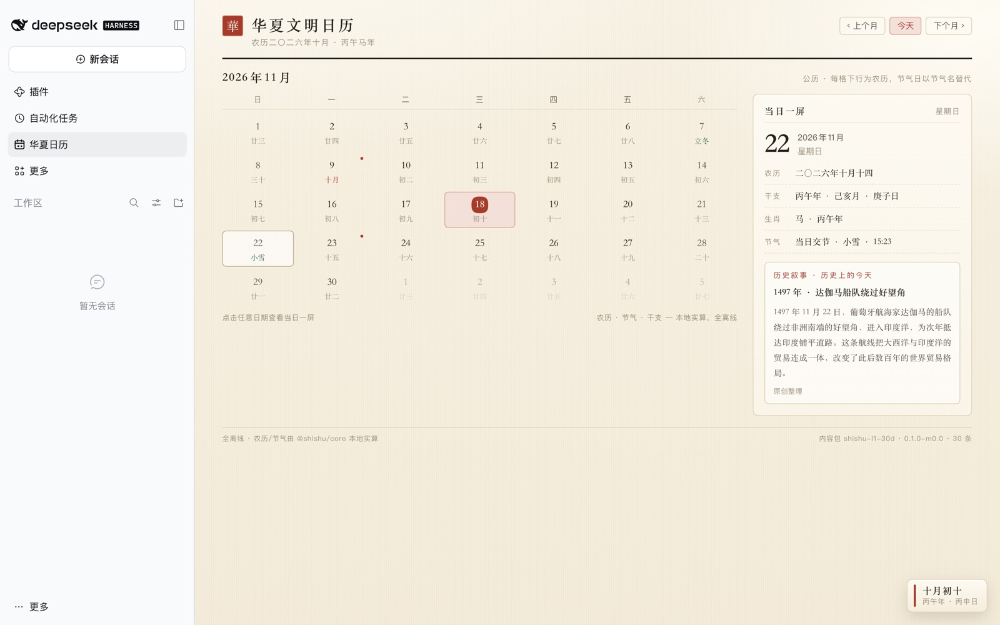
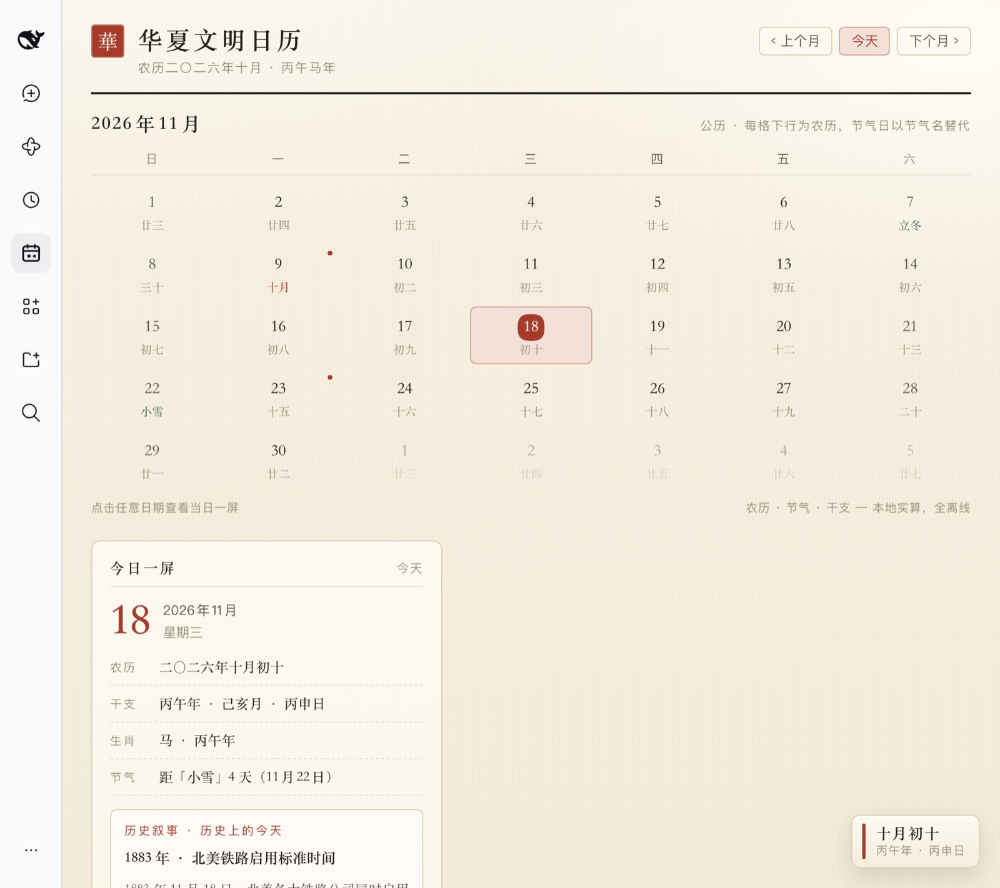

# 华夏文明日历插件 · huaxia-calendar-plugin

一个能装在 DeepSeek Harness 侧栏/主面板里的华夏文明日历——公历+农历+节气+干支+历史叙事，纯本地离线可用。


> **当前版本：`0.1.0-m0.0`（M0′）** —— 能装、能开、能看到真日历。
> 月历 + 农历/节气/干支 + 今日一屏 + 30 天历史叙事 + 右下角常驻浮标。
> 365 天全量内容、每日卦象、Token 统计、主题皮肤属于 M1。

---

## 一、怎么装（就三步，不用开命令行）

安装包已经放在仓库里：**`release/huaxia-calendar-dsh-0.1.0-m0.0.tgz`**（140 KB）。

1. 打开 DeepSeek Harness，左侧栏点 **「插件」**
2. 点 **「添加插件」** 右边的小箭头 → 选 **「安装第三方插件」**
3. 在输入框里粘贴这个文件的**完整路径**，点 **「安装」**
   ```
   /Volumes/C/豆包学习/日历/huaxia-calendar-plugin/release/huaxia-calendar-dsh-0.1.0-m0.0.tgz
   ```
4. 安装完成后点 **「立即启用」**，然后**重启一次 GUI**（新插件要宿主重新加载才生效）

重启后左侧栏会出现 **「华夏日历」**，点开就是月历 + 今日一屏；右下角还有一个常驻的「十月初十 / 丙午年·丙申日」浮标。

> 说明：这个对话框同时接受**包名、Git 地址、压缩包、本地路径**四种来源。我们这次用的是「本地压缩包」，因为它完全离线、不需要网络、也不需要你先装任何开发工具。

### 卸载 / 升级

- 卸载：插件页 → 已安装插件 → 华夏文明日历 → 移除
- 升级：**先移除再安装新包**（同版本号重复安装会被 pnpm 判定「已是最新」而复用旧产物）

---

## 二、为什么它不在「插件市场（发现）」里？

「发现」页是**索引源驱动**的：它读取一份插件索引（列出条目、版本、下载来源），条目指向**已发布到 npm 的包**。我们这个插件目前：

- ✅ 已经是一个标准的 DSH 插件包（有 `dsh.bundle.patch`、`dsh.client` 清单，能被安装器识别）
- ❌ 还没有发布到 npm，所以任何索引里都不会有它

要让它出现在市场里，需要两步额外工作：

1. **发布到 npm**（需要 npm 账号 + 令牌）：`npm publish release/huaxia-calendar-dsh-0.1.0-m0.0.tgz`
2. **提供一个插件索引源**（一个 JSON 文件，托管在任意 https 地址），然后在「发现 → 添加索引源」里加上它

发布后，你就能在「添加插件」里直接输入包名 `huaxia-calendar-dsh` 安装，不再需要路径。这两步属于发布工程，需要你提供 npm 账号或明确授权后我再做。

---

## 三、给开发者：构建 / 测试 / 打包

<details>
<summary>展开：从源码构建与验证（普通使用不需要看）</summary>

前置：Node ≥ 22.18。

```sh
npm install
npm test          # 72 项：核心算法 44 + 内容包 8 + UI 逻辑 20
npm run build     # 构建插件 bundle（lib/client.js）
npm run verify    # 离线校验 bundle 接缝 + 三席位注册 + 与 core 实算对账
npm run typecheck # 对着 dsh 0.2.2-rc.1 类型检查（防宿主版本漂移）
npm run package   # 产出 release/dist tarball
```

开发依赖**必须精确 pin `0.2.2-rc.1`**：npm `latest` 标签指向废弃的 `0.0.1-rc.1`，直接 `npm i` 会装错版本。

命令行安装（等价于上面的 GUI 三步，适合脚本化/内网批量部署）：

```sh
node scripts/install.mjs --profile web
# 或 dsh plugin --profile web add release/huaxia-calendar-dsh-0.1.0-m0.0.tgz
```

为什么主推 tarball 而不是 git 地址直装：git 来源需要作者提供自包含 `prepare`，且用户要在 profile 的 `pnpm-workspace.yaml` 里 `allowBuilds` 授权包在安装期执行代码，第一次必定失败一次（GUI 里会给出「允许这些脚本并重试」按钮）。tarball 零构建、零网络，更适合内网/离线。

</details>

---

## 四、现在能做什么

| 能力 | 状态 |
|------|------|
| 公历 + 农历双轨月历（初一显月名、冬月/腊月别名、闰月） | ✅ |
| 24 节气标注（含交节时刻、倒计时） | ✅ |
| 干支（年/月/日）、生肖 | ✅ |
| 今日一屏：公历 + 农历 + 干支 + 生肖 + 节气 + 当天一条历史叙事 | ✅ |
| 侧栏入口 + 全局面板 + 右下角常驻「今日」浮标 | ✅ |
| 30 天文明史叙事（全部原创 / 公有领域，无 CC BY-SA 污染） | ✅ 30 条 |
| 全离线运行（农历/节气/干支本地实算，零网络请求） | ✅ |
| 365 天全量内容、每日卦象、Token 统计、任务清单、主题皮肤 | ⏳ M1 |

## 五、界面

| 月历 + 今日一屏 | 点节气日（当日交节 · 小雪 · 15:23） |
|---|---|
|  |  |

| 无会话首页也会显示「今日」浮标 | 窄视口自适应 |
|---|---|
|  |  |

## 六、仓库结构

| 路径 | 说明 |
|------|------|
| `packages/core/` | `@shishu/core`：农历/节气/干支/节日纯函数 + 内容 schema（44 测试；vendor `lunar-javascript` MIT，已带 LICENSE） |
| `packages/content-l1/` | `@shishu/content-l1`：30 天文明史叙事内容包（`self-authored`）+ 发布前校验 |
| `packages/ui-react/` | `@shishu/ui-react`：宿主无关 React 组件（`CalendarPanel` / `TodayPill`）+ 纯逻辑测试 |
| `packages/host-dsh/` | `huaxia-calendar-dsh`：DeepSeek Harness 插件壳（三席位注册、bundle 构建、verify） |
| `release/` | 可直接安装的插件包（`.tgz`） |
| `scripts/` | `package.mjs`（构建 + 打包）、`install.mjs`（命令行装进 profile） |
| `docs/phase0/` | Phase 0 四份可行性文档（宿主 / 算法 / 内容 / 结论） |
| `spikes/dsh-hello/` | Phase 0 最小可验证插件（可复现的证据，非产品代码） |

## 七、技术架构

```
@shishu/core          纯 TS 纯函数：农历 / 24 节气 / 干支 / 节日 / 内容 schema
                      零框架、零运行时依赖、全离线，Node 与浏览器双端可用
      ↑
@shishu/content-l1    L1 内容包（JSON，构建期内嵌进 bundle）
      ↑
@shishu/ui-react      React 18 组件（宿主无关，可直接搬进 VS Code webview）
      ↑
huaxia-calendar-dsh   宿主壳：sidebar.panellist + main + shell.overlay
                      产物是 window.__ModuleLoader__.load({id, factory}) bundle
```

**关键约束（Phase 0 实测结论，别踩）**：

- UI 必须是 **React 18 组件**：DSH 的 slot 契约传 React 组件，Web Components 拿不到 props/hook。
- React 由宿主提供，**不要打包自己的 React**（external）。
- 宿主不提供 CSS Modules 管线 → 样式用 **CSS 变量 + 内联 style**，不引外部 CSS 文件。
- 席位名集中写在 [`packages/host-dsh/src/client/seats.ts`](packages/host-dsh/src/client/seats.ts)，DSH 升级只改这一处。

## 八、内容合规

- 内容许可：**仅 `self-authored` / `public-domain`**。公开的「历史上的今天」数据集许可证不可用（无 LICENSE，或用 MIT 外壳包装维基 CC BY-SA + 百度内容），随包分发会触发署名与相同方式共享义务。详见 [内容层可行性](docs/phase0/内容层可行性.md)。
- 每日卦象（M1）：严格定位为传统文化知识，**禁止**宜/忌/吉/凶/财运/姻缘等预测性表述。
- 审核清单：[docs/content-review-checklist.md](docs/content-review-checklist.md)。数据 schema 强制 `source` / `license` 字段，`validateContentPack` 会在缺许可证时阻断发布。

## 九、路线图

- **M0′（已完成）**：DSH 全局面板 + 月历 + 农历/节气/干支 + 今日一屏 + 30 天内容 + tarball 分发
- **M1**：Token 自动采集（按天精确）+ 每日卦象（限文化知识）+ 主题皮肤 + 365 天全量内容
- **M2**：VS Code / MarsCode 适配、离线内容包、代码价值可视化
- **M3**：Tauri 独立桌面版（OS 级置顶）、历史长河时间轴

## 十、已知问题

- 浏览器内 E2E 只在隔离实例（端口 3201/3202/3203）验证，未触碰日常使用的 3080 GUI。
- 视觉主题固定宣纸浅色，无深色模式、无主题切换（M1）。
- 内容包构建期内嵌：改内容后需重跑 `npm run build` 并重新打包。
- 2057 年等未来日期与部分官方历表有已知 1 天分歧（算法文档 §6.5 有记录）。

## 十一、规划文档

- [整体规划方案（飞书云文档）](https://my.feishu.cn/docx/MZ5xdwZ4eodKdCxIF7RceWGBnee)
- [「时枢」可交互规划页](https://mcnnwkkt1uji.feishu.cn/page/BHWGmDubHdNg2IaiEDQcYCqynsc)
- [docs/整体规划方案.md](./docs/整体规划方案.md)（本仓库离线副本，部分假设已被 Phase 0 修正）
- [Phase 0 证据与结论](./docs/phase0/结论与下一步.md)
