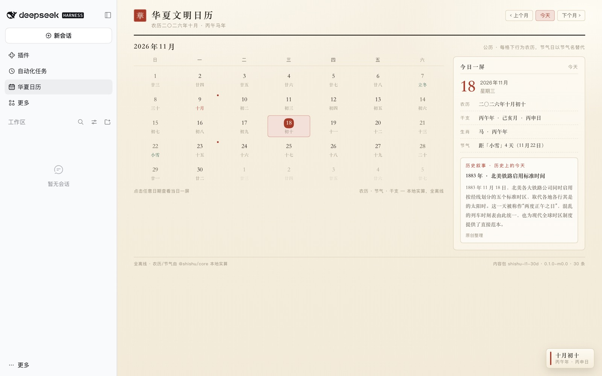
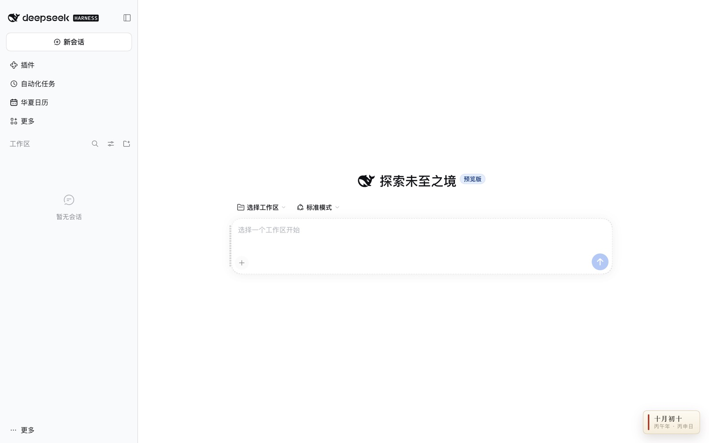

# 华夏文明日历插件 · huaxia-calendar-plugin

一个能装在 AI 编码工具侧边栏/主面板里的华夏文明日历——公历+农历+节气+干支+历史叙事，纯本地离线可用。



> **当前状态：M0′ 已交付（2026-11-18）——能装、能开、能看到真日历。**
> 在 DeepSeek Harness `0.2.2-rc.1` 上实测通过：tarball 安装 → 侧栏出现「华夏日历」→ 月历 + 今日一屏 + 常驻浮标，控制台 0 报错。
> 只有 30 天内容样板（11-18 至 12-17），全量 365 天与 Daily 卦象、Token 统计按路线图后置。

## 现在能做什么

| 能力 | 状态 |
|------|------|
| 公历 + 农历双轨月历（初一显月名、冬月/腊月别名、闰月） | ✅ 已实现 |
| 24 节气标注（含交节时刻、倒计时） | ✅ 已实现 |
| 干支（年/月/日）、生肖 | ✅ 已实现 |
| 今日一屏：公历 + 农历 + 干支 + 生肖 + 节气 + 当天一条历史叙事 | ✅ 已实现 |
| 侧栏入口 + 全局面板 + 右下角常驻「今日」浮标 | ✅ 已实现 |
| 30 天文明史叙事（全部原创 / 公有领域，无 CC BY-SA 污染） | ✅ 30 条 |
| 全离线运行（农历/节气/干支本地实算，零网络请求） | ✅ 已实现 |
| 365 天全量内容、每日卦象、Token 统计、任务清单、主题皮肤 | ⏳ M1 起 |

## 安装（DeepSeek Harness）

前置：`dsh` 已在 PATH（或知道其路径）、Node ≥ 22.18。

```sh
# 1) 构建 + 打包（产出 dist/huaxia-calendar-dsh-<version>.tgz，约 140 KB）
npm install
npm run package

# 2) 装进 profile（默认 web；也可 --profile <name>）
node scripts/install.mjs --profile web
#   等价于：dsh plugin --profile web add dist/huaxia-calendar-dsh-<version>.tgz

# 3) 重启 dsh GUI（或刷新页面），左栏出现「华夏日历」
```

卸载：

```sh
dsh plugin --profile web remove huaxia-calendar-dsh
```

> **为什么是 tarball 而不是 git 地址直接装？**
> Phase 0 实测：git 来源安装需要作者提供自包含 `prepare`、且用户必须在 profile 的 `pnpm-workspace.yaml` 里 `allowBuilds` 授权包在安装期执行代码，**第一次必定失败**，不是「3 条命令无脑装」。
> tarball 零构建、零网络，是内网/离线环境唯一干净路径（详见 [Phase 0 宿主可行性](docs/phase0/宿主可行性.md) 第四节）。
>
> **更新时注意**：同版本号重打 tarball 再 `add` 会被 pnpm 判定 `Already up to date` 而复用旧产物。要么先 `remove` 再 `add`，要么把版本号 +1。

## 验证

```sh
npm test          # 全部 workspace 测试：核心算法 44 + 内容包 8 + UI 逻辑 20
npm run build     # 构建插件 bundle
npm run verify    # 离线校验 bundle 接缝、三席位注册、月历/节气/农历与 core 实算对账
npm run typecheck # 对着 dsh 0.2.2-rc.1 类型做类型检查（防宿主版本漂移）
```

`npm run verify` 的实际输出（可复现）：

```
registered         : sidebar.panellist    huaxia-calendar        华夏日历
registered         : main                 huaxia-calendar
registered         : shell.overlay        huaxia-calendar.today
month grid         : 35 格 (5 行 × 7)
today (core 对账)  : 二〇二六年十月初十 · 丙午年 · 丙申日
solar terms (本月) : 立冬、小雪
today narrative    : 1883 年 北美铁路启用标准时间
OK: bundle 通过模块加载器接缝，注册 3 个席位，月历/节气/农历/叙事与 core 实算一致。
```

## 界面

| 月历 + 今日一屏 | 点节气日（当日交节 · 小雪 · 15:23） |
|---|---|
|  |  |

| 无会话首页也会显示「今日」浮标 | 窄视口自适应 |
|---|---|
|  |  |

## 仓库结构

| 路径 | 说明 |
|------|------|
| `packages/core/` | `@shishu/core`：农历/节气/干支/节日纯函数 + 内容 schema（44 测试；vendor `lunar-javascript` MIT，已带 LICENSE） |
| `packages/content-l1/` | `@shishu/content-l1`：30 天文明史叙事内容包（`self-authored`）+ 发布前校验 |
| `packages/ui-react/` | `@shishu/ui-react`：宿主无关 React 组件（`CalendarPanel` / `TodayPill`）+ 纯逻辑测试 |
| `packages/host-dsh/` | `huaxia-calendar-dsh`：DeepSeek Harness 插件壳（三席位注册、bundle 构建、verify） |
| `scripts/` | `package.mjs`（构建 + 打包）、`install.mjs`（装进 profile） |
| `docs/phase0/` | Phase 0 四份可行性文档（宿主 / 算法 / 内容 / 结论） |
| `spikes/dsh-hello/` | Phase 0 最小可验证插件（可复现的证据，非产品代码） |

## 技术架构

```
@shishu/core          纯 TS 纯函数：农历 / 24 节气 / 干支 / 节日 / 内容 schema
                      零框架、零运行时依赖、全离线，Node 与浏览器双端可用
      ↑
@shishu/content-l1    L1 内容包（JSON，构建期内嵌进 bundle）
      ↑
@shishu/ui-react      React 18 组件（宿主无关，可直接搬进 VS Code webview）
      ↑
huaxia-calendar-dsh   宿主壳：sidebar.panellist + main + shell.overlay
                      产物是 window.__ModuleLoader__.load({id, factory}) bundle
```

**关键约束（Phase 0 实测结论，别踩）**：

- UI 必须是 **React 18 组件**：DSH 的 slot 契约传 React 组件，Web Components 拿不到 props/hook。
- React 由宿主提供，**不要打包自己的 React**（external）。
- 宿主不提供 CSS Modules 管线 → 样式用 **CSS 变量 + 内联 style**，不引外部 CSS 文件。
- 开发依赖**必须精确 pin `0.2.2-rc.1`**：npm `latest` 标签指向废弃的 `0.0.1-rc.1`。
- 席位名集中写在 [`packages/host-dsh/src/client/seats.ts`](packages/host-dsh/src/client/seats.ts)，DSH 升级只改这一处。

## 内容合规

- 内容许可：**仅 `self-authored` / `public-domain`**。公开的「历史上的今天」数据集许可证不可用（无 LICENSE，或用 MIT 外壳包装维基 CC BY-SA + 百度内容），随包分发会触发署名与相同方式共享义务。详见 [内容层可行性](docs/phase0/内容层可行性.md)。
- 每日卦象（M1）：严格定位为传统文化知识，**禁止**宜/忌/吉/凶/财运/姻缘等预测性表述。
- 审核清单：[docs/content-review-checklist.md](docs/content-review-checklist.md)。数据 schema 强制 `source` / `license` 字段，`validateContentPack` 会在缺许可证时阻断发布。

## 路线图

- **M0′（已完成）**：DSH 全局面板 + 月历 + 农历/节气/干支 + 今日一屏 + 30 天内容 + tarball 分发
- **M1**：Token 自动采集（按天精确）+ 每日卦象（限文化知识）+ 主题皮肤 + 365 天全量内容
- **M2**：VS Code / MarsCode 适配、离线内容包、代码价值可视化
- **M3**：Tauri 独立桌面版（OS 级置顶）、历史长河时间轴

## 已知问题 / 未做

- 浏览器内 E2E 只在隔离实例（端口 3201/3202）验证，未触碰日常使用的 3080 GUI。
- 视觉主题固定宣纸浅色，无深色模式、无主题切换（M1）。
- 内容包构建期内嵌：改内容后需重跑 `npm run build`。
- 2057 年等未来日期与部分官方历表有已知 1 天分歧（算法文档 §6.5 有记录）。

## 规划文档

- [整体规划方案（飞书云文档）](https://my.feishu.cn/docx/MZ5xdwZ4eodKdCxIF7RceWGBnee)
- [「时枢」可交互规划页](https://mcnnwkkt1uji.feishu.cn/page/BHWGmDubHdNg2IaiEDQcYCqynsc)
- [docs/整体规划方案.md](./docs/整体规划方案.md)（本仓库离线副本，部分假设已被 Phase 0 修正）
- [Phase 0 证据与结论](./docs/phase0/结论与下一步.md)
