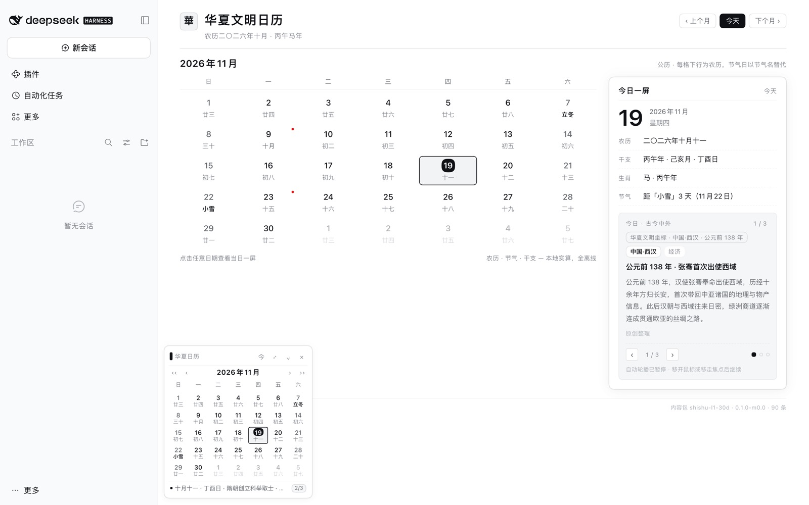
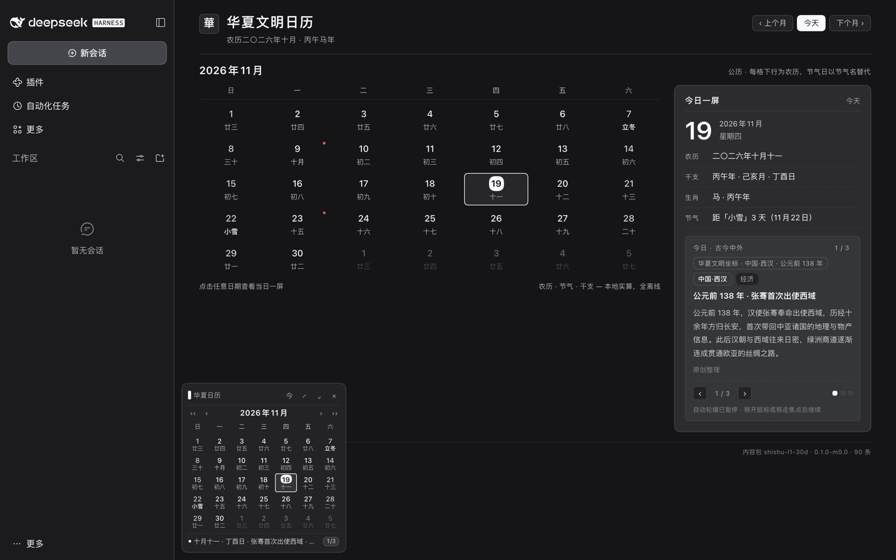

# 使用说明

适用于华夏文明日历 0.3.0。安装环境：DeepSeek Harness 0.2.2-rc.1。

## 一、安装

安装包在本仓库的 `release/` 目录中，文件名形如 `huaxia-calendar-dsh-0.3.0.tgz`。

### 方式一：界面安装（推荐）

1. 左侧栏点击 **插件**。
2. 点击 **添加插件** 右侧的下拉箭头，选择 **安装第三方插件**。
3. 在输入框中填入安装包的完整路径，点击 **安装**。

   输入框接受四种来源：npm 包名、Git 地址、压缩包链接、本机文件路径。使用本机文件时，需要填写该文件在这台电脑上的**实际绝对路径**，例如：

   ```
   /Users/<用户名>/Downloads/huaxia-calendar-dsh-0.3.0.tgz
   ```

   获取方法：在 Finder 中选中安装包文件 → 按住 `Option` 键右键 →「拷贝“文件名”为路径名」，再粘贴到输入框。

4. 安装完成后，在完成页点击 **立即启用**。
5. 完全退出并重新启动 DeepSeek Harness。

### 方式二：命令行安装

```sh
dsh plugin --profile web add /安装包在本机上的绝对路径/huaxia-calendar-dsh-0.3.0.tgz
```

`web` 为实际使用的 profile 名称。安装后同样需要重启。

### 方式三：从源码构建

需要 Node.js 22.18 或更高版本。

```sh
git clone https://github.com/Sirealize/huaxia-calendar-plugin.git
cd huaxia-calendar-plugin
npm install
npm run package
```

产物输出至 `release/`，随后按方式一或方式二安装。

## 二、安装后在哪里找

插件**不会**在左侧栏占用菜单项。入口有两处：

1. **左下角月历**：重启后自动出现在主内容区左下角，显示当月每一天。
2. **设置**：打开 **设置**，左侧导航底部有 **华夏日历** 分区。

如果左下角没有出现月历，进入 **设置 → 华夏日历**，确认「在角落显示月历」处于开启状态。

## 三、界面说明

### 左下角月历


- 显示当月每一天，每格为公历日 + 农历日；有节气的日期显示节气名（如「立冬」「小雪」）。
- 今日以宿主强调色标记。
- 顶部导航：`‹‹` `‹` 翻年／翻月，`›` `››` 反向，`今` 回到本月。
- 点击某一天，底部一行显示该日的农历、干支、节气或历史叙事标题；当天有多条叙事时显示 `1 / 3` 计数，点击计数可切到下一条。
- 标题栏右侧按钮：`⤢` 打开完整月历，`⌄` 收起为小条，`×` 关闭。
- **拖动**：按住标题栏可拖到窗口内任意位置，位置会被记住（刷新、重启后保持）。
- **收起／展开**：点 `⌄` 收起为一条只显示今日农历与干支的小条，点 `⌃` 展开。
- 所有状态（位置、收起、显示与否）保存在浏览器本地，与账号无关。

> 默认位置在主内容区左下角，而不是窗口绝对左下角，以避免遮挡左侧栏底部的设置入口。需要时直接拖动即可。

### 完整月历



从设置分区或左下角月历的 `⤢` 按钮进入：

- 每格显示公历日与农历日，初一显示月名（如「十月」）；有节气的日期显示节气名。
- 今日以宿主强调色标记；顶部提供「上个月」「今天」「下个月」。
- 右侧「今日一屏」显示所选日期的公历、农历、干支、生肖、节气。
- 下半部分为**每日轮播**：每天三条历史叙事，以中华文明为主体、兼及世界。
  - `‹` `›` 切换、`1 / 3` 计数、底部圆点可跳转到任意一条；
  - 每 8 秒自动轮播，鼠标悬停或键盘聚焦时暂停，移开后继续；
  - 容器可聚焦，`←` / `→` 键也可切换；
  - 只有一条时隐藏切换控件，当天无条目时显示「今日暂无条目」。
- 点击任一日期，右侧内容随之切换，轮播回到第 1 条。

### 两条目的口径

轮播卡片上的标签表示内容口径，两者混排：

| 标签 | 含义 |
| --- | --- |
| **历史上的今天** | 事件确实发生在该公历日期（可核实），多为近现代事件与有明确日期的世界事件。 |
| **华夏文明坐标** | 只以「年份 + 朝代」入档的文明坐标，仅表示这是华夏文明史的一部分，**不代表当天发生**。先秦至清的事件多属此类，因为古代以干支、农历纪日，无法换算到公历月日。 |

这样既能保证「历史上的今天」不掺假，又能让轮播里始终有足够的华夏文明内容。区块标题在当天没有「历史上的今天」条目时会相应变为「华夏文明坐标 · 古今中外」。

### 外观

插件不定义自己的颜色与字体，全部使用宿主主题变量：

- 切换深色／浅色主题时自动跟随。
- 在设置中调整界面字号时，日历文字同步缩放。



## 四、日常使用

- 平时看左下角月历：今天高亮，当天的农历与节气一目了然。
- 需要查某个日期：点小月历上的那一天，底部会显示当日信息。
- 需要详细内容（历史叙事、完整月历）：点 `⤢` 或从设置进入完整月历页面。
- 不想看到它：设置 → 华夏日历 → 关闭「在角落显示月历」；或点卡片的 `×`。

## 五、更新与卸载

**更新**：插件页 → 已安装插件 → 华夏文明日历 → 移除，然后安装新版本。同一版本号重复安装时，包管理器会判定为「已是最新」并沿用旧文件，因此必须先移除。

**卸载**：插件页 → 已安装插件 → 华夏文明日历 → 移除，然后重启。

## 六、问题排查

| 现象 | 处理方式 |
| --- | --- |
| 左侧栏没有「插件」入口 | 当前 profile 未启用插件页。可改用命令行安装：`dsh plugin --profile <profile名> add <安装包路径>`，安装后重启。 |
| 找不到「安装第三方插件」 | 「添加插件」为分体按钮：点击主按钮右侧的下拉箭头，菜单中即为「安装第三方插件」。 |
| 安装时提示路径无效 | 确认填写的是安装包的**完整绝对路径**，而非目录。 |
| 重启后看不到左下角月历 | 设置 → 华夏日历 → 打开「在角落显示月历」；若仍没有，检查插件页中该插件是否处于启用状态。 |
| 找不到完整月历 | 设置 → 华夏日历 → 「打开完整日历」；或左下角月历标题栏的 `⤢`。 |
| 左下角月历挡住了界面元素 | 按住标题栏拖走；或点 `⌄` 收起；或在设置中关闭。 |
| 安装时提示版本不兼容 | 插件声明的宿主版本为 0.2.2-rc.1。若当前宿主版本不同，需在插件声明中调整兼容范围。 |
| 历史叙事显示「今日暂无条目」 | 当前内容覆盖 2026-11-18 至 2026-12-17，区间外属预期行为。 |

## 七、数据与隐私

- 农历、节气、干支均由本地算法计算，不访问网络。
- 历史叙事随插件打包，运行时不下载。
- 月历的位置、收起状态等偏好只保存在本机浏览器本地存储中。
- 插件不收集、不上报任何使用数据。
